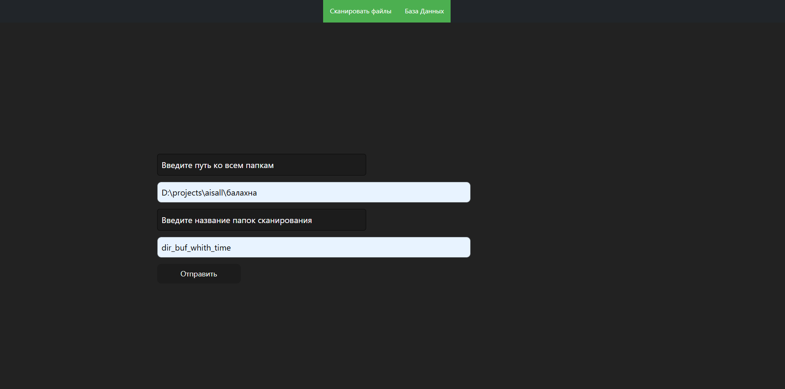
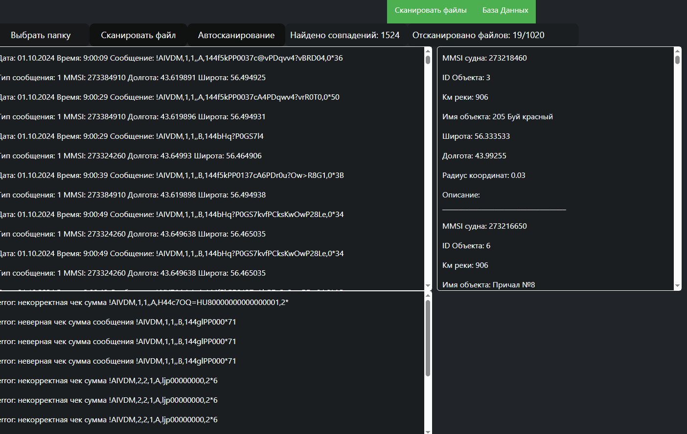
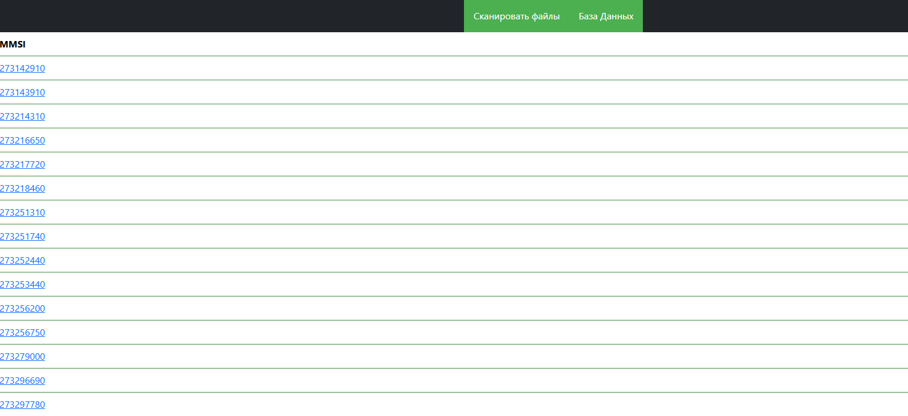
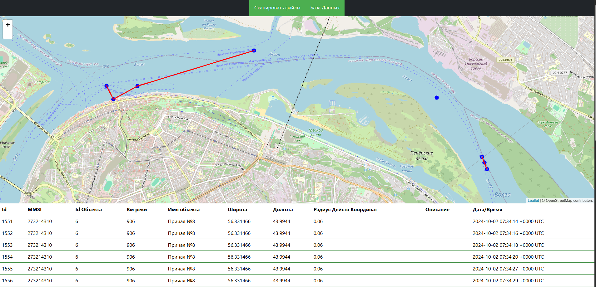
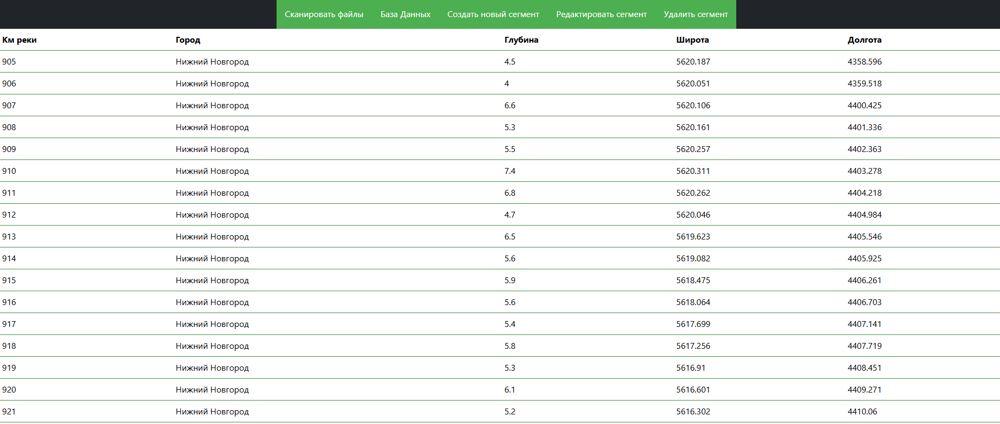
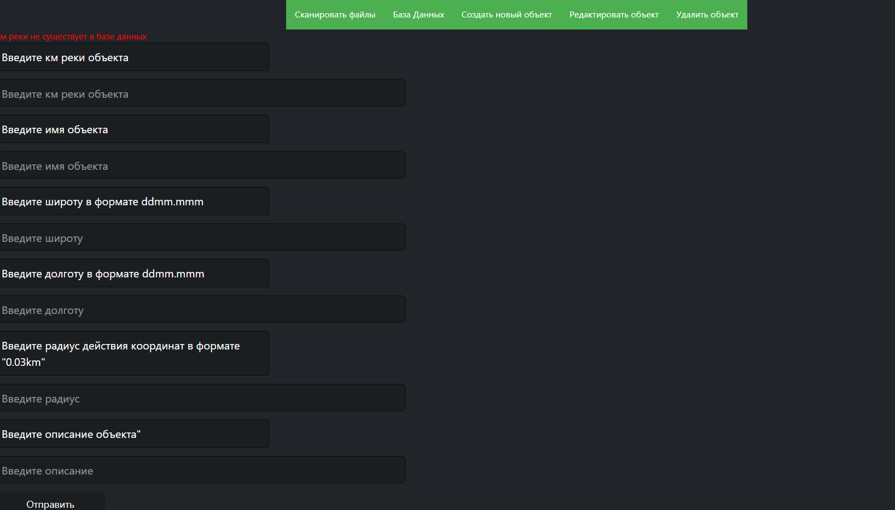

Приложение предназначено для **обработки AIS-сообщений**, их проверки и отображения на веб-интерфейсе с возможностью работы с базой данных.

---

## Основные возможности

### Работа с AIS-файлами
- ✅ Считывание строк из файла с датой без даты. (Пример: 01.10.2024 0:02:58 !AIVDM,1,1,,B,B44dqw0000iuol`4s1ehSwtUoP06,0*3D)
- ✅ Обработка битых и слитых строк с попыткой вырезать полезную информацию.  (Пример: 01.10.2024 0:02:58 !AIVDM,1,1,,B,B44dqw0000iuo!AIVDM,1,1,,B,B44dqw0000iuol`4s1ehSwtUoP06,0*3D)
- ✅ Исключение второго сообщения, если первое не найдено для двусоставных сообщений AIS.  
- ✅ Возможность разделения сообщений по типу.  
- ✅ Проверка контрольной суммы сообщений.  
- ✅ Сравнение данных ais с данными из бд.  
- ✅ Форматирование координат.  
- ✅ Определение радиуса и проверка совпадений объектов в радиусе.  
- ✅ Сохранение новой точек судов в базу данных.  
- ✅ Интерфейс для заполнения базы данных на сайте CRUD операции.  
- ✅ Оптимизация запросов БД для ускорения работы программы.  
- ✅ Вывод метрик о скорости работы программы в консоль. 

### Веб-интерфейс
- ✅ Окно сканирования с кнопкой для запуска процесса.  
- ✅ Форма для выбора папки, из которой сканировать файлы.  
- ✅ Отображение данных базы данных (судна, объекты, сообщения, ошибки).  
- ✅ Завершение сканирования с уведомлением о завершении.  
- ✅ Редактирование записей базы данных через веб-интерфейс.  
- ✅ Автосканирование с периодическим обновлением данных.  
- ✅ Пагинация для удобного просмотра больших наборов данных.  

### Скриншоты рабочего проекта
- Окно выбора пути и папок для сканирования

- Страница сканирования 

- Страница с найденными судами,при выборе страница с их данными и картой маршрутов

- Страница с данными,которые можно добавлять через форму.

- Страница с формой,вывод ошибки при неправильных данные, страница успеха при успешном добавлении

### Карта и визуализация
- ✅ Использование данных для построения карты с отображением маршрутов.  
- ✅ Уникальные точки на карте, чтобы снизить нагрузку на визуализацию.  

### Api

| Метод | Путь | Описание | Параметры |
|-------|------|----------|-----------|
| GET | / | Главная страница | — |
| POST | /foldercheck | Указать папку для сканирования | path, folder |
| POST | /newfolder | Прервать скан и выбрать новую папку | — |
| GET | /scan | Окно сканирования | — |
| POST | /reload | Запуск сканирования | — |
| POST | /reloadauto | Автосканирование | — |
| GET | /segments | Просмотр сегментов | — |
| GET | /segments/new | Форма добавления сегмента | — |
| POST | /segments/new | Добавить сегмент | km, city, depth, latitude, longitude |
| GET | /segments/edit | Форма редактирования сегмента | — |
| POST | /segments/edit | Редактировать сегмент | id, city, depth, latitude, longitude |
| GET | /segments/delete | Форма удаления сегмента | — |
| POST | /segments/delete | Удалить сегмент | km |
| GET | /objects | Просмотр объектов | — |
| GET | /objects/new | Форма добавления объекта | — |
| POST | /objects/new | Добавить объект | objkm, objname, objlatitude, objlongitude, objradius, objdescription |
| GET | /objects/edit | Форма редактирования объекта | — |
| POST | /objects/edit | Редактировать объект | objid, objkm, objname, objlatitude, objlongitude, objradius, objdescription |
| GET | /objects/delete | Форма удаления объекта | — |
| POST | /objects/delete | Удалить объект | objid |
| GET | /mmsi | Список уникальных MMSI | — |
| GET | /mmsi/{mmsi} | Проверка совпадений MMSI | page |
| GET | /api/messages | Сообщения из файлов | limit, offset |
| GET | /api/objects | Найденные объекты | limit, offset |
| GET | /api/errors | Ошибки сканирования | limit, offset |
| GET | /api/count | Статистика файлов и совпадений | — |
| GET | /static/... | Статические файлы (JS, CSS, изображения) | — |